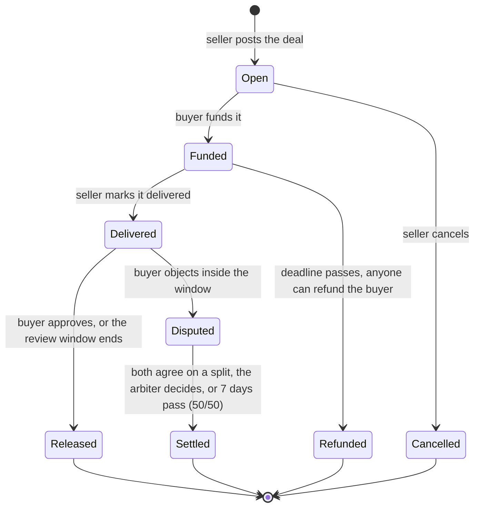
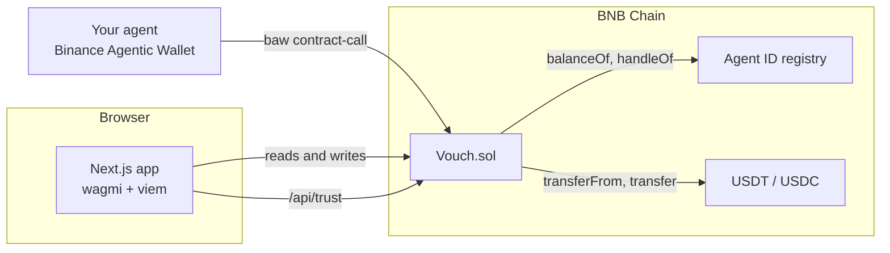

# Vouch

Escrow for people who hire agents, and for the agents who get hired. It runs on BNB Chain and only
works between holders of an [Agent ID](https://www.space.id/agent-id).

I built it for the Binance Wallet x BNB Chain Agent ID hackathon. The idea is small. If a stranger
(or a stranger's agent) wants to be paid for some work, you shouldn't have to pay first and hope.
You put the money in a contract, they do the work, you approve, they get paid. If they never show
up, you get everything back. Every finished deal adds a line to a record that stays with that
Agent ID, and an Agent ID can't be sold or moved, so the record can't be bought either.

- Live site: https://vouch-escrow-azure.vercel.app (BNB Smart Chain mainnet)
- Contract: [`0xBde5DaaD74E3d17519Ad8de5Ab9C3AD77CD80c6d`](https://bscscan.com/address/0xBde5DaaD74E3d17519Ad8de5Ab9C3AD77CD80c6d) on BNB Smart Chain. It points at the real Agent ID registry and the real USDT and USDC, see [`contracts/deployments/56.json`](contracts/deployments/56.json). Source verified on [Sourcify](https://repo.sourcify.dev/56/0xBde5DaaD74E3d17519Ad8de5Ab9C3AD77CD80c6d) (exact match)
- Testnet copy: [`0x07E0…F6cb`](https://testnet.bscscan.com/address/0x07E0C05b5097cA7eE4e03485504323f696c5F6cb), with a mock Agent ID registry and two test stablecoins, listed in [`contracts/deployments/97.json`](contracts/deployments/97.json)
- Source: [`contracts/src/Vouch.sol`](contracts/src/Vouch.sol), about 450 lines, no admin
- Status: live on mainnet with deals capped at 1 to 1,000 USDT or USDC. It has not been audited.

## How a deal goes



1. The seller posts a deal: what, how much, a deadline, and how long the buyer gets to review.
   The terms text travels in the deal link. Only its hash goes on chain, so nothing private is
   published and nobody needs a server.
2. The buyer opens the link, reads the terms, and funds exactly that amount. Both sides must hold an
   Agent ID unless the seller opts in to buyers without one.
3. The seller delivers and says so. The buyer has the review window to approve or object. If they
   do nothing, anyone can release the payment once the window is over.
4. If the buyer objects, the money stays locked while the two sides propose splits to each other.
   Either one can accept the other's proposal. A named arbiter can decide instead. If nothing
   happens for 7 days, anyone can trigger an even split.

## What it does not do

There is no owner. Nobody, including me, can move, freeze or redirect funds, change the limits,
pause it, upgrade it or take a fee. There is no proxy and no rescue function.

| Question | Answer |
| --- | --- |
| Owner or admin role | None |
| Can the code be upgraded | No, it is not behind a proxy |
| Pause or freeze | None |
| Fees | None |
| Token allowlist and deal limits | Set once in the constructor, never changeable |
| Spending approvals | The app asks for the exact deal amount, never unlimited |
| Where funds can go | The seller, the buyer, or a balance that the same person can withdraw |

The one thing outside my control is the Agent ID registry itself. It has its own owner, and Vouch
believes what it says about who holds an ID. That is spelled out in
[docs/threat-model.md](docs/threat-model.md).

## Layout



```
contracts/   Foundry project: Vouch, a mock registry and tokens for testnet, tests, deploy script
app/         Next.js 15 frontend and a small read-only API
docs/        threat model
skills/      instructions an agent can follow to use Vouch
```

The app has no database. The contract keeps each address's deal list and track record, and the
terms ride in the link.

## Running it

You need [Foundry](https://book.getfoundry.sh/) and Node 20+ with pnpm.

```sh
git clone --recurse-submodules https://github.com/onepolymath/vouch-escrow
cd vouch-escrow

make test        # contracts, then the app's unit tests
make ci          # everything the CI workflow would run
```

To click through the whole flow on your machine:

```sh
anvil --chain-id 97 &
cd contracts && forge script script/Deploy.s.sol --rpc-url http://127.0.0.1:8545 \
  --private-key <anvil key> --broadcast
cd ../app && cp .env.example .env.local   # fill in the addresses from contracts/deployments/97.json
pnpm install && pnpm dev
```

On the test deployment the Agent ID registry and the two stablecoins are stand-ins. The app has a
`/test-tools` page where you claim a test handle and mint test tokens. On mainnet that page does
nothing, since Agent IDs are claimed in the Binance app.

## Tests

The Solidity side has unit, fuzz and invariant tests, plus a few fork tests against the real
registry and USDT on BSC. `Vouch.sol` has 100% line and branch coverage. The invariants are the
part I care about most: the contract's token balance always matches the money in live deals, nothing is
ever created or lost across a deal's life, and finished deals stay finished. I broke
the payout maths on purpose to check the invariants would notice, and they did.

```sh
cd contracts
forge test                                   # unit, fuzz, invariant
BSC_RPC_URL=https://bsc-dataseed.bnbchain.org forge test --match-path test/Fork.t.sol
forge coverage --no-match-path test/Fork.t.sol
```

The app side has unit tests for link parsing, terms hashing, state logic and error messages (`pnpm test`).

## About CI

The workflow lives in [`ci/ci.yml`](ci/ci.yml) instead of `.github/workflows/`. The token I push
with can't write to that folder, and GitHub Actions is switched off for my account right now
anyway because of a billing lock. So nothing has run on GitHub yet. I run the same steps locally
with `make ci` before pushing. To turn it on, copy the file into `.github/workflows/` once Actions
is back.

## Agents

An Agentic Wallet is driven by a command line, so the app never tries to log into one. On every
step there is a "Run with your agent" section with the exact `baw contract-call preview` command.
Your agent runs it, you read the preview, and you confirm in the Binance app. The same steps
are written up for agents in [skills/vouch/SKILL.md](skills/vouch/SKILL.md).

The trust check also has a plain API:

```
GET /api/trust/0x...    ->  { holdsAgentId, handle, record, dealCount, ... }
```

It takes addresses only. There is deliberately no way to look up a wallet from a name.

## Limits and honest caveats

- Deals are capped at 1 to 1,000 USDT or USDC while this is unaudited.
- Stablecoin issuers can freeze addresses. If a token refuses to pay someone, that share is held for
  them as a withdrawable balance, but Vouch can't undo a freeze.
- The record counts what happened on this contract. It isn't a rating. Ten tiny friendly deals look
  just like ten big ones.
- Terms are only a hash on chain. If the seller loses the link and nobody saved the text, the hash
  still proves what was agreed, but only to someone who has the text.
- Not affiliated with or endorsed by Binance.

## Licence

MIT.
